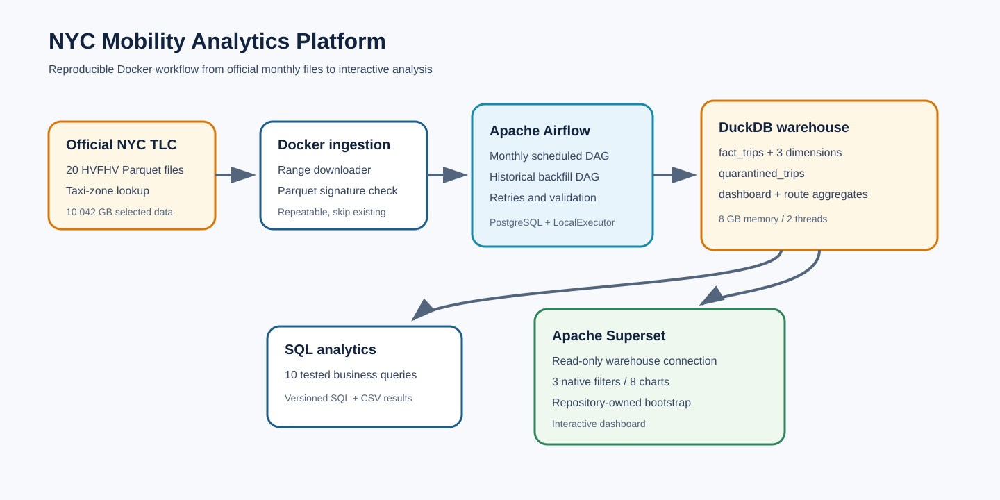

# NYC Mobility Analytics Platform

An end-to-end data engineering project for 411.8 million official NYC TLC High-Volume For-Hire Vehicle (HVFHV) trip records. It loads a dimensional DuckDB warehouse, preserves rejected records in quarantine, orchestrates repeatable monthly processing with Airflow, and serves an interactive Superset dashboard.

## Verified project result

| Measure | Value |
|---|---:|
| Source months | 2025-01 through 2026-08 |
| Official Parquet files | 20 |
| Raw size | 10,042,368,958 bytes (10.042 GB / 9.353 GiB) |
| Raw records | 411,776,395 |
| Accepted fact rows | 411,739,486 |
| Quarantined rows | 36,909 |
| Reconciliation difference | 0 |

The production database is `warehouse/nyc_mobility.duckdb`. It is deliberately excluded from Git.

## Architecture



DuckDB runs with an 8 GB memory limit and two threads during ETL and aggregate refreshes. Superset mounts the warehouse read-only. Airflow uses PostgreSQL metadata and LocalExecutor so the backfill controller can wait for triggered monthly DAG runs without deadlocking.

## Requirements

- Docker Desktop 4.x or Docker Engine with Compose v2
- x86-64 or Apple Silicon host
- At least 12 GB free RAM; 16 GB recommended
- About 35 GB free disk for the selected raw files, warehouse, images, and Docker volumes
- Windows: WSL 2 backend and Linux containers

No Python, DuckDB, Airflow, or Superset installation is required on the host.

## Quick start

1. Create local configuration:

   ```bash
   cp .env.example .env
   ```

   Replace every `change-me` value. Generate a long random Superset secret with a password manager or another trusted local tool.

2. Build the images:

   ```bash
   docker compose build
   ```

3. Download a configurable inclusive month range from the official TLC file host:

   ```bash
   docker compose --profile tools run --rm downloader \
     --start 2025-01 --end 2026-08
   ```

   The downloader is repeatable. Existing files are skipped unless `--force` is supplied. It validates the Parquet container signature before replacing a destination file.

4. Initialize the empty warehouse:

   ```bash
   docker compose --profile tools run --rm warehouse-init
   ```

5. Start Airflow, PostgreSQL, and Superset:

   ```bash
   docker compose up -d postgres airflow superset-init superset superset-bootstrap
   ```

6. Open the UIs:

   - Airflow: [http://localhost:8080](http://localhost:8080)
   - Superset: [http://localhost:8088](http://localhost:8088)

   The Superset one-shot bootstrap creates the read-only DuckDB connection, dataset, three native filters, eight charts, and the `NYC HVFHV Mobility Analytics` dashboard from repository code.

## Load data

### One month from the command line

```bash
./etl/load_month.sh 2026-08
```

The script runs DuckDB in Docker. The monthly SQL transaction groups exact duplicates, classifies every applicable rejection reason, replaces the selected month safely, validates dimension matches, and checks raw = accepted + quarantined before commit.

### Airflow backfill

In Airflow, trigger `nyc_historical_backfill` with:

```json
{
  "start_month": "2025-01",
  "end_month": "2026-08"
}
```

The controller validates the range and triggers `nyc_monthly_etl` sequentially for each selected month. The monthly DAG is also scheduled at 06:00 on the fifth day of each month through the August 2026 project cutoff. Each task retries once after one minute.

## Refresh dashboard aggregates

After a new ETL load:

```bash
docker compose --profile tools run --rm warehouse-optimize
docker compose up --force-recreate --no-deps superset-bootstrap
```

The refresh creates `agg_dashboard_trip_metrics` and `agg_route_metrics` transactionally. It does not rewrite `fact_trips`.

## Analytics and benchmarks

Run the ten analyses and write versionable CSV results:

```bash
./scripts/run_analytics.sh
```

Run the reproducible benchmark SQL with DuckDB timers:

```bash
./scripts/benchmark_optimizations.sh
```

Measured median improvements on the production warehouse:

| Optimization | Original | Optimized | Median speedup |
|---|---:|---:|---:|
| Timestamp range enabling zone-map pruning | 8.535 s | 0.146 s | 58.5x |
| Persistent dashboard aggregate | 13.655 s | 0.281 s | 48.6x |

Both pairs returned identical trip and fare totals. Caching was not counted as an optimization.

## Validation

```bash
make validate
docker compose ps
```

Useful read-only warehouse check:

```bash
docker run --rm --entrypoint duckdb \
  --mount "type=bind,source=$PWD/warehouse,target=/warehouse,readonly" \
  duckdb/duckdb:1.5.6 -readonly /warehouse/nyc_mobility.duckdb \
  -c "SELECT COUNT(*) FROM fact_trips;"
```

## Windows deployment

Use Docker Desktop with the WSL 2 backend. Clone the repository inside the WSL filesystem, not under `/mnt/c`, to avoid slow bind mounts. Allocate at least 12 GB RAM and 4 CPUs to Docker Desktop. The ETL still caps DuckDB at 8 GB and two threads. Full instructions are in [docs/windows-deployment.md](docs/windows-deployment.md).

## Documentation

- [Technical report (PDF)](output/pdf/nyc_mobility_technical_report.pdf)
- [Final presentation (PowerPoint)](output/presentation/nyc_mobility_final_presentation_v2.pptx)
- [Technical report](docs/technical_report.md)
- [Architecture and dimensional model](docs/architecture.md)
- [Data quality and ETL rules](docs/data-quality.md)
- [Airflow scheduling and recovery](docs/airflow.md)
- [Ten SQL analyses and findings](docs/analytics.md)
- [Performance benchmarks](docs/performance.md)
- [Superset dashboard guide](docs/dashboard.md)
- [Windows deployment](docs/windows-deployment.md)

## Repository hygiene

`.gitignore` excludes raw Parquet data, DuckDB files and spill directories, Docker application state, logs, caches, and `.env`. `.env.example` contains only placeholders. The repository is prepared for publication but is not published by this project workflow.
