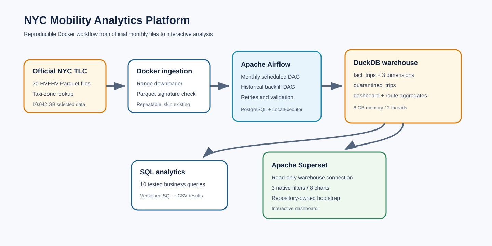
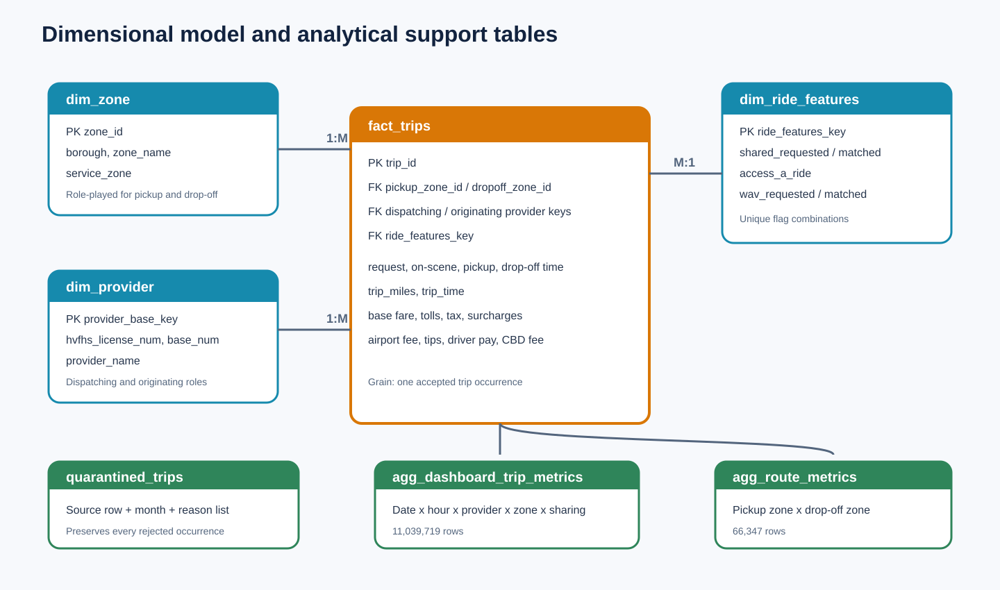

# Architecture and dimensional model

## End-to-end flow

1. `scripts/download_tlc_data.py` downloads official monthly HVFHV Parquet files and the taxi-zone lookup.
2. Airflow schedules or manually triggers `etl/load_month.sql` through the monthly DAG.
3. DuckDB reads Parquet directly, validates source records, loads dimensions and facts, and preserves rejects in `quarantined_trips`.
4. The optimizer refreshes compact aggregate tables for repeated dashboard workloads.
5. Superset connects to the same production database through a read-only bind mount and read-only DuckDB connection.

## Dimensional model

### Grain

One row in `fact_trips` represents one accepted source trip occurrence after exact duplicate handling. The table contains pickup/drop-off timestamps, location and provider foreign keys, a ride-feature foreign key, distance, duration, fare components, tips, and driver pay.

### Dimensions

- `dim_zone`: 265 TLC zones keyed by `zone_id`, including borough, zone name, and service zone. Source records with unmatched pickup or drop-off IDs are quarantined.
- `dim_provider`: stable surrogate key for each HVFHV license and base-number combination. The project window contains Uber and Lyft accepted trips; Juno and Via remain supported in the mapping.
- `dim_ride_features`: unique combinations of shared-ride, Access-A-Ride, and wheelchair-accessible-vehicle flags.

### Keys and unknowns

The ETL creates stable numeric surrogate keys for provider/base and ride-feature combinations. It validates that every accepted fact resolves all required foreign keys before insertion. Unknown or unmatched zones are quarantined rather than assigned to an artificial member because they would corrupt geographic findings.

### Supporting tables

- `quarantined_trips` preserves rejected source columns, the source month, and a list of every applicable rejection reason.
- `agg_dashboard_trip_metrics` has date, hour, provider, pickup zone, and sharing-state grain for Superset.
- `agg_route_metrics` has pickup/drop-off zone grain for route analysis.
- `optimization_metadata` records the aggregate refresh time and fact-table coverage.
