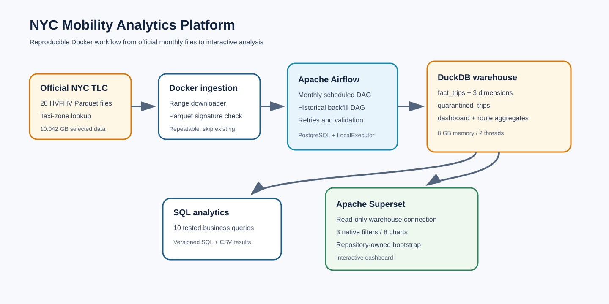
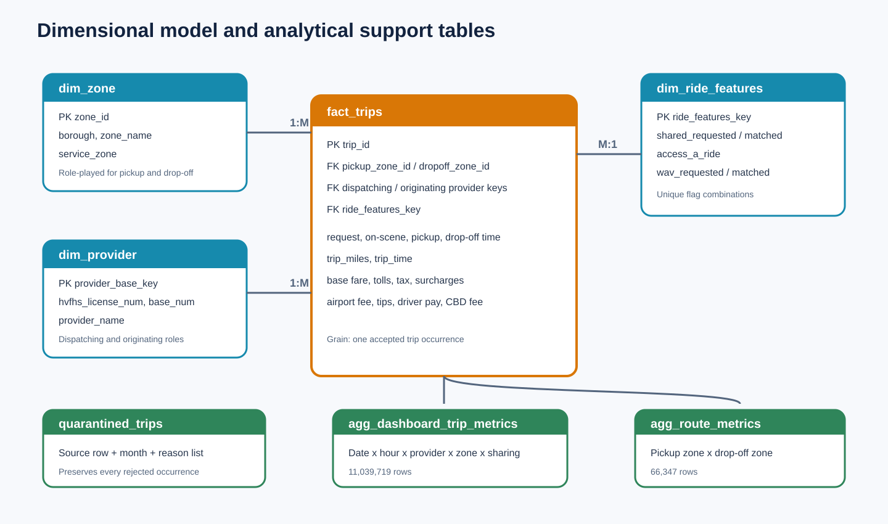
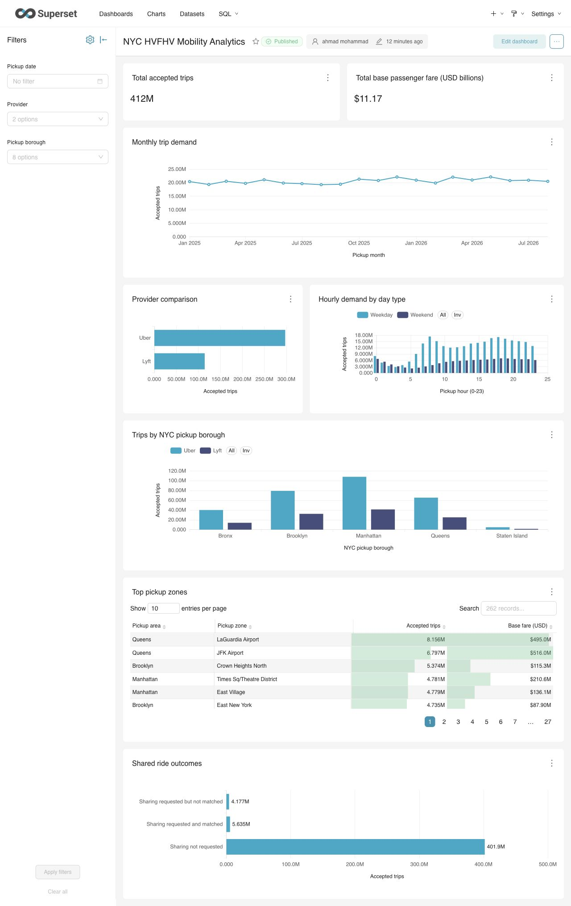

# NYC Mobility Analytics Platform

Technical report - 5 November 2026

## Executive summary

This project transforms 20 official NYC TLC HVFHV Parquet files into a repeatable analytical platform. The selected files cover January 2025 through August 2026 and total 10.042 GB. The transactional DuckDB ETL reconciled all 411,776,395 source rows: 411,739,486 accepted and 36,909 quarantined, with zero unexplained difference.

Apache Airflow schedules monthly processing, validates every loaded month, and supports parameterized historical backfills. Apache Superset connects read-only and serves a repository-generated interactive dashboard. Two measured optimizations improved representative analytical workloads by 58.5x and 48.6x at median while returning identical results.

## Business context and objectives

The platform supports analysis of NYC for-hire trip demand, provider position, time-of-day patterns, geographic demand, airport travel, sharing outcomes, and fare behavior. The official project brief requires dimensional modeling, data quality handling, safe reruns, orchestration with failure recovery, at least eight non-trivial SQL analyses, two meaningful performance optimizations, an interactive Superset dashboard, and reproducible documentation.

## Data sources

- Official page: <https://www.nyc.gov/site/tlc/about/tlc-trip-record-data.page>
- File host: `https://d37ci6vzurychx.cloudfront.net/trip-data/`
- Dataset: High-Volume For-Hire Vehicle Trip Records only
- Selected period: 2025-01 through 2026-08
- Files: 20 monthly Parquet files
- Raw size: 10,042,368,958 bytes (10.042 GB / 9.353 GiB)
- Zone reference: official TLC taxi-zone lookup

The selected period meets the approximate 10 GB requirement. HVFHV data begins in February 2019, so no claim is made that HVFHV records exist from 2017. The analysis is limited to the selected 20 months and does not represent earlier market conditions.

## Technical architecture

The official downloader writes monthly Parquet files to a bind-mounted data directory. Airflow triggers the parameterized SQL pipeline. DuckDB performs transformation and stores a star-like dimensional model plus quarantine records. The optimizer creates compact tables for interactive use. Superset sees the warehouse through a read-only mount. Docker Compose manages PostgreSQL, Airflow, Superset, and one-shot initialization services.

Technology choices emphasize a complete laptop demonstration: DuckDB scans Parquet efficiently without a distributed cluster; Airflow provides visible dependencies and retries; PostgreSQL supports LocalExecutor; Superset provides interactive filtering; Docker isolates every dependency from the host.

## Warehouse design

The fact grain is one accepted trip occurrence. `fact_trips` stores timestamps, zone keys, provider/base keys, a ride-feature key, distance, duration, fare components, tips, and driver pay. `dim_zone`, `dim_provider`, and `dim_ride_features` supply descriptive attributes. Surrogate provider and ride-feature keys remain stable across reruns. The ETL refuses unresolved keys before fact insertion.

## Data quality and transformations

Exact duplicates are grouped before classification. The ETL quarantines invalid time order, negative distance, month mismatch, inconsistent or invalid ride flags, missing timestamps, and unmatched zone identifiers. Every rejected record preserves all applicable reasons. The first valid occurrence of an exact duplicate remains accepted, while later occurrences enter quarantine.

Measured outcome:

| Result | Rows |
|---|---:|
| Raw | 411,776,395 |
| Accepted | 411,739,486 |
| Quarantined | 36,909 |
| Difference | 0 |

Reason counts are 24,657 inconsistent-sharing records, 12,237 invalid-duration records, and 17 duplicate occurrences. Reasons may overlap.

Each monthly run occurs in one transaction. A safe rerun deletes and replaces only the chosen month. Validation compares the source Parquet count with accepted and quarantined counts, checks dimension resolution, and rejects invalid accepted state before success.

## Orchestration and recovery

The monthly DAG follows `initialize_warehouse -> load_month -> validate_month`. It runs at 06:00 on the fifth day of each month through the project cutoff, permits one active run, and retries once after one minute. Manual runs accept a month parameter.

The backfill DAG validates an inclusive range and triggers the monthly DAG sequentially. This pattern respects DuckDB's single-writer behavior. A missing source file produces an explicit task failure before SQL execution. After the official file is restored, clearing or rerunning the task is safe because the transaction and monthly replacement logic are repeatable.

## Performance

### Timestamp predicate

A function-wrapped month comparison required a broad scan. Rewriting it as a half-open timestamp range enabled zone-map pruning. Across three measured runs, median time fell from 8.535 seconds to 0.146 seconds, a 58.5x improvement. Both versions returned 20,490,900 trips and $552,408,127.14 for August 2026.

### Dashboard aggregate

The baseline joined and grouped the 411.7M-row fact table. The optimized query rolled up the persistent dashboard aggregate. Across three measured runs, median time fell from 13.655 seconds to 0.281 seconds, a 48.6x improvement. A two-way set comparison confirmed identical 256 groups totaling 411,739,486 trips and $11,168,662,827.90.

The aggregate refresh took 76 seconds and created 11,039,719 dashboard rows plus 66,347 route rows. The refresh cost is paid once after ETL rather than at every interaction.

## SQL analytics and findings

Ten queries cover monthly trends, provider comparison, pickup zones, hourly demand, boroughs, routes, borough movement, airports, sharing, and distance/fare behavior.

Key findings:

- Uber carries 72.22% of accepted trips; Lyft carries 27.78%.
- LaGuardia and JFK are the two highest-volume pickup zones.
- Weekday average daily demand peaks at 08:00; weekend demand peaks at 18:00.
- Manhattan supplies 36.23% of five-borough pickup volume and has the highest average base fare.
- Queens has the highest cross-borough share at 27.60% and the longest average trip distance.
- The 1-3 mile band contains 39.62% of trips. Unit fare declines as distance increases.

The complete questions, results, and interpretations are in `docs/analytics.md`; SQL and CSV outputs remain in the repository.

## Superset dashboard

The repository bootstrap creates a read-only DuckDB database connection, the dashboard aggregate dataset, three native filters, eight charts, and the published dashboard. Filters cover pickup date, provider, and pickup borough. Visuals include total-trip and base-fare KPIs, monthly trends, provider comparison, hourly demand, borough demand, top pickup zones, and shared outcomes.

The dashboard exists as code in `superset/bootstrap_dashboard.py`, so a fresh Superset metadata volume can recreate it. Live verification on Superset 6.0.0 rendered the 412M trip KPI, $11.2B base-fare KPI, all eight charts, and all three filters. The pickup-date filter now targets the dataset's configured temporal column on every applicable chart. Provider, borough, and date filters work separately and together. Superset's standard `Clear all` then `Apply filters` flow returns every chart to its unfiltered state without stale results.

## Deployment and portability

Docker Compose is the only required runtime. The downloader, DuckDB initializer, optimizer, Airflow, PostgreSQL, and Superset all run in containers. The workflow supports x86-64 Windows with Docker Desktop/WSL 2 and macOS/Linux. DuckDB is capped at 8 GB and two threads, which fits the ThinkPad T470p with 32 GB RAM.

Secrets and state stay outside Git. `.gitignore` excludes `.env`, raw Parquet data, DuckDB files, spill directories, logs, caches, and application volumes. `.env.example` documents required values without containing credentials.

## Limitations

- The analysis covers January 2025 through August 2026 only.
- Base passenger fare excludes other fare components unless a query adds them explicitly.
- Provider comparisons use the dispatching provider/base relationship.
- Taxi zones represent administrative polygons, not exact pickup coordinates.
- Superset metadata uses SQLite inside its local volume for the laptop demo; the analytical warehouse remains DuckDB and Airflow metadata uses PostgreSQL.

## Reproduction checklist

1. Copy `.env.example` to `.env` and set secrets.
2. Build Docker images.
3. Download the selected official month range.
4. Initialize the warehouse.
5. Start Airflow and execute the historical backfill.
6. Refresh aggregate tables.
7. Start Superset and run the dashboard bootstrap.
8. Execute analytics and benchmarks.
9. Confirm the warehouse reconciliation and UI health.

## References

- NYC TLC Trip Record Data: <https://www.nyc.gov/site/tlc/about/tlc-trip-record-data.page>
- Apache DuckDB: <https://duckdb.org/>
- Apache Airflow: <https://airflow.apache.org/>
- Apache Superset: <https://superset.apache.org/>

## Appendix: project entry points

- ETL: `etl/load_month.sql`
- Monthly runner: `etl/load_month.sh`
- Airflow DAGs: `airflow/dags/`
- Analytics: `sql/analytics/`
- Optimizations: `sql/optimizations/`
- Downloader: `scripts/download_tlc_data.py`
- Superset dashboard: `superset/bootstrap_dashboard.py`
- Container stack: `docker-compose.yml`
